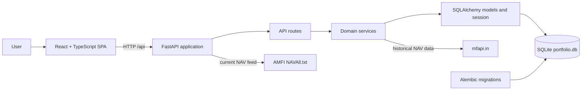

# Application Architecture

This document describes how the frontend, API, domain services, and database fit together. It is
an application-level map; see [API.md](API.md) for endpoint contracts and [DATABASE.md](DATABASE.md)
for the full schema and persistence details.

## System Context

The application is a local-first mutual fund portfolio manager. A browser-based React client talks
to a FastAPI backend over JSON HTTP. The backend owns validation, investment calculations, and all
database access. SQLite is the default persistent store; AMFI and mfapi.in provide current and
historical NAV data respectively.



## Runtime Components

### Frontend

The frontend is a React 18 + TypeScript single-page application built and served by Vite.

- `frontend/src/App.tsx` defines navigation and page routes: Dashboard, Transactions, SIPs, Entries
  Due, Import, Schemes, and Accounts.
- `frontend/src/routes/` contains page-level workflows; `frontend/src/components/` contains shared
  interface elements.
- `frontend/src/lib/api.ts` is the typed HTTP boundary. It serializes request data, parses API
  errors, and exposes functions used by pages and components.
- `frontend/src/types/api.ts` mirrors the API's request and response shapes. TanStack Query manages
  server-state fetching and refresh; TanStack Table and Recharts support table and chart views.
- The client does not calculate authoritative portfolio values, commission, or transaction rules.
  It displays backend results and submits user-confirmed input.

In development, Vite serves the SPA at `http://localhost:5173` and proxies `/api` requests to the
backend at `http://localhost:8000`. The production hosting arrangement is not currently part of
the application runtime configuration.

### Backend

The backend is a FastAPI application, normally started with Uvicorn from `backend/`.

- `backend/main.py` creates the app, configures CORS, and registers the health and `/api` routers.
- `backend/api/routes/` adapts HTTP requests to application operations. Routes use dependency
  injection for the database session and current user, and delegate domain work to services.
- `backend/schemas/` defines and validates API inputs and outputs. Decimal values are serialized
  as JSON numbers for the browser.
- `backend/services/` contains business rules and calculations, including transactions, FIFO lots,
  commissions, XIRR, dashboard aggregation, SIP scheduling, imports, NAV sync, and portfolio
  history.
- `backend/models/` defines SQLAlchemy persistence entities. `backend/db/` configures the engine,
  sessions, exact-decimal column types, and database-specific upsert behavior.
- `backend/core/config.py` supplies environment-driven settings and local defaults. No background
  scheduler is used: NAV synchronization is initiated by an API request.

Authentication is bearer-token (JWT) based; see [API.md](API.md#authentication). Every `/api`
router is mounted with the `get_current_user` dependency except the login/admin router, and
user-owned data is scoped through that identity. The frontend shows a login page until a valid
token is held, and clears all cached query data on sign-out.

### Database and Migrations

SQLite is the default database, stored at `backend/portfolio.db`. SQLAlchemy provides database
sessions and ORM mapping; Alembic applies versioned schema migrations. The major entity groups are:

- **Ledger and ownership:** users, accounts, transactions.
- **Scheme reference data:** AMFI schemes, user display names, statement-name aliases, and daily NAV
  history for schemes held by the user.
- **Recurring investments:** SIP mandates and skipped occurrences; confirmed SIP entries become
  ordinary transaction rows.
- **Imports and calendar:** import batches and staged rows, plus market holidays used to schedule
  trading-day-adjusted SIP occurrences.

Money, NAV, and units are represented as `Decimal` in application code and stored at fixed
precision as text in SQLite. This avoids binary floating-point drift. Because these values are text
in SQLite, financial aggregation and ordering are performed in Python by the service layer rather
than with SQL aggregate functions. SQLite foreign keys are enabled per connection, with WAL mode
and a busy timeout configured for local operation.

The transaction ledger is the source of truth for investment activity. Transactions are
soft-deleted rather than physically removed. Portfolio values, FIFO cost basis, realized and
unrealized gains, and XIRR are calculated from active ledger rows when requested; they are not
maintained as cached totals in separate tables.

## Main Data Flows

### Read and Write Requests

1. A routed frontend page invokes a typed function from `frontend/src/lib/api.ts`.
2. FastAPI matches the request to a route, validates inputs with Pydantic schemas, and injects the
   current user and SQLAlchemy session.
3. The route calls a service, which enforces domain rules and reads or changes ORM entities.
4. The session is closed by the request dependency. The response schema serializes the result back
   to the frontend.

Portfolio dashboard endpoints compute derived figures from the ledger and current scheme NAVs.
Transaction creation and edits derive commission on the server; redemptions are checked against
units held. SIP occurrences and imported rows do not become ledger entries until the user confirms
them.

### NAV Synchronization

The user starts synchronization from the application. The backend fetches and parses AMFI's
`NAVAll.txt`, then upserts the current reference data into `schemes`. It also requests historical
NAV series from mfapi.in for schemes appearing in the user's transaction history and inserts new
scheme/date observations into `scheme_nav_history`. The current NAV snapshot and historical series
have separate roles: current portfolio valuation versus the dashboard's value-over-time chart.

### Statement Import

An uploaded workbook is parsed into an import batch and staged rows. The user resolves account and
scheme mappings in the import workflow; the backend records reusable scheme aliases. Committing a
batch creates ledger transactions, while duplicate detection prevents accidental repeat imports.
Staging alone does not affect portfolio calculations.

## Architectural Boundaries and Constraints

- **Backend owns financial rules.** Browser values are inputs or presentation; calculations and
  validations that affect the ledger run in Python services.
- **Ledger-first, derived-on-read.** This keeps changes, restores, and soft deletes reflected in
  calculations without invalidating stored summaries. It is appropriate for the current local
  dataset size, but large-scale growth may require measured optimization.
- **External data is explicit.** NAV sync is user-triggered, not scheduled. Historical NAV
  prefill is a convenience and does not create a transaction or establish ledger values by itself.
- **SQLite is a deliberate local deployment choice.** `DATABASE_URL` is configurable through
  settings, but the exact-decimal text columns and SQLite-specific upsert path need review before
  changing database engines. A file-based SQLite database also requires persistent storage if the
  app is hosted on an ephemeral filesystem.
- **Schema changes are migration-managed.** Model changes should be accompanied by an Alembic
  migration; tests can create isolated databases independently.

## Source and Operations

```text
frontend/                 React application and Vite configuration
backend/main.py           FastAPI application entry point
backend/api/routes/       HTTP endpoints
backend/schemas/          API validation and serialization
backend/services/         Domain logic and calculations
backend/models/           SQLAlchemy entities
backend/db/               Engine, sessions, custom types, persistence helpers
backend/alembic/          Versioned database migrations
backend/tests/            Service and HTTP integration tests
```

For local startup and verification commands, see [README.md](README.md#running-it-locally) and
[README.md testing instructions](README.md#testing).